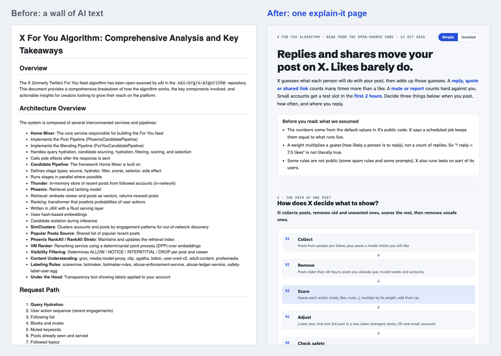
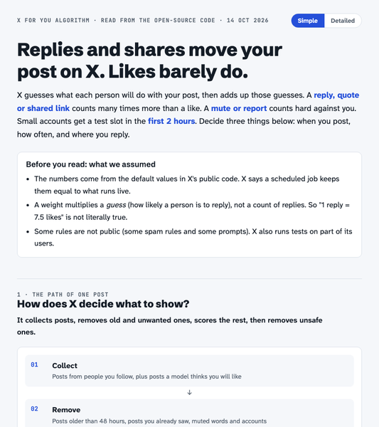
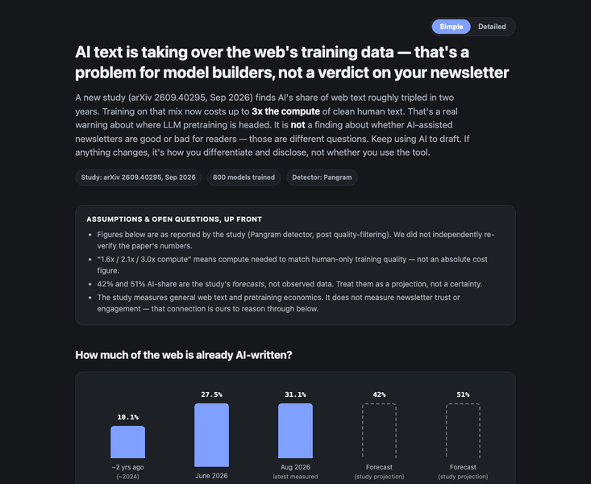

# explain-it

**Stop reading walls of AI text. Get one page instead.**

`explain-it` is a skill for Claude (and other AI agents). When you ask for research, a plan, a comparison or results, your AI gives you one clear HTML page: the answer first, a diagram before any paragraph, and every decision you need to make right where it belongs, with buttons.



## The three rules

1. **The title is the answer, not the topic.** "Replies and shares move your post on X. Likes barely do." Not "X algorithm analysis".
2. **A diagram before any paragraph.** Every section opens with a visual: bars drawn to scale, a flow, a 2×2 map, a comparison table. The text explains the visual.
3. **Decisions sit where they belong.** Each choice you must make appears on the section it changes, with options as buttons and one option marked *Suggested*. One click copies your answers back to the AI.

The idea comes from [Andrej Karpathy's ladder](https://x.com/karpathy/status/2105819303471976479) for how AI should explain things: plain words, then diagrams, then a page you can click, then video. This skill is step three.

## What every page has

| Part | What it does |
|---|---|
| Answer title + "the answer" paragraph | You know the conclusion in 10 seconds |
| Assumptions up front | Nothing important is hidden in paragraph four |
| Sections written as questions | "Which actions count most?", answered in the first line |
| One visual per section | Picked by content: bars, flow, step row, 2×2 map, table, mockup, scorecard |
| Decisions in place | Radio buttons, a *Suggested* option, a "3 to answer" counter |
| Simple / Detailed switch | Simple shows the story. Detailed adds tables, notes and sources |
| Light and dark mode, phone width | Readable anywhere |
| "What we still do not know" + next steps | Ends with what happens next |

## Install

### Claude Code: plugin (one command each)

```
/plugin marketplace add NavSha/explain-it
/plugin install explain-it@explain-it
```

### Claude Code: copy the folder

```bash
git clone https://github.com/NavSha/explain-it.git
mkdir -p ~/.claude/skills
cp -r explain-it/skills/explain-it ~/.claude/skills/
```

Restart Claude Code. The skill is now in `~/.claude/skills/explain-it/` with `SKILL.md` and `lint.py`.

### Claude.ai or the Claude desktop app

Download `explain-it.zip` from [Releases](https://github.com/NavSha/explain-it/releases) and upload it as a skill in Claude's settings.

### ChatGPT, Codex, Cursor and other agents

Paste [`SKILL.md`](skills/explain-it/SKILL.md) at the top of your chat, or add it to your agent's instructions file (for example `AGENTS.md`).

## Use it

Ask for anything big, then say **"explain it"**. For example:

- "Research the top 5 note-taking apps for students and explain it."
- "Compare these three pricing plans and put it on a page."
- "Here is my launch plan. Help me understand the risks."
- "Summarize this paper so I can decide if it matters for my product."

The skill also starts on "help me understand", "make this easy to digest", "show me the plan" and "put this on a page". It stays out of the way for short answers and small fixes.

## Examples

Open them in your browser. Both pages work in light and dark mode and on a phone.

| | |
|---|---|
| [](https://navsha.github.io/explain-it/examples/x-algorithm/) | **[Replies and shares move your post on X. Likes barely do.](https://navsha.github.io/explain-it/examples/x-algorithm/)**<br>Read from X's open-source ranking code. Flow diagram, weights as bars to scale, 3 decisions.<br>Compare with the [Markdown version](examples/x-algorithm/before-markdown-wall.md) of the same content. |
| [](https://navsha.github.io/explain-it/examples/ai-web-text/) | **[AI text is taking over the web's training data](https://navsha.github.io/explain-it/examples/ai-web-text/)**<br>A research paper summary. Made by a fresh Claude Code session with only this skill installed. |

Each example folder also has the page's Markdown record, which the skill keeps next to every page.

## Check a page (optional)

`lint.py` catches the mistakes that happen most often. It needs only Python 3, with no packages to install.

```bash
python3 ~/.claude/skills/explain-it/lint.py page.html
```

- **Errors** (fix these): no answer title, a broken dark theme, a decision with no suggested option or no way to send answers back, a file path that does not exist.
- **Warnings** (judge these): headings that are not questions, sections with no visual, words like "leverage" or "utilize", sentences over 28 words.

The skill tells the AI to run it before it shows you the page.

## Repo layout

```
skills/explain-it/SKILL.md   the skill
skills/explain-it/lint.py    the page checker
.claude-plugin/              Claude Code plugin files
examples/                    two finished pages, with their Markdown records
tests/                       tests for lint.py (python3 -m pytest tests)
```

## Credits

- Andrej Karpathy, for the ladder: [plain writing → diagram → interactive page → video](https://x.com/karpathy/status/2105819303471976479).
- Made by Navneet ([@build.with.navneet](https://www.instagram.com/build.with.navneet/) on Instagram). If it helps you, a star or a tag is welcome.

## License

[MIT](LICENSE). Use it, change it, share it.
